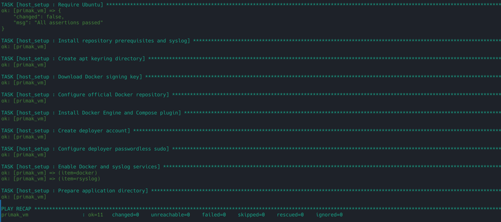
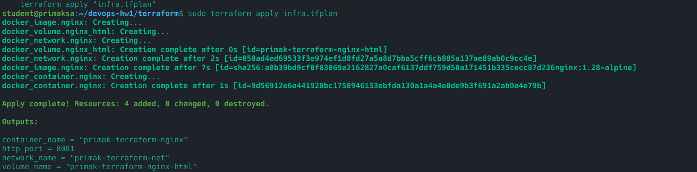
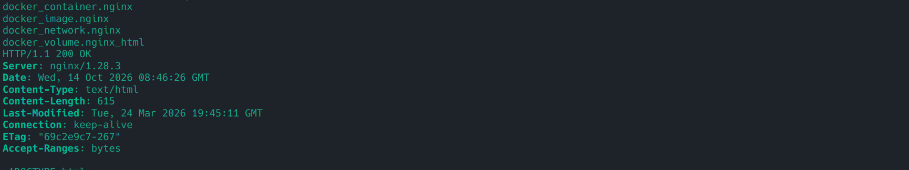
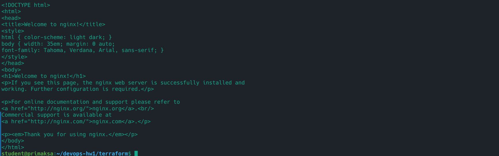
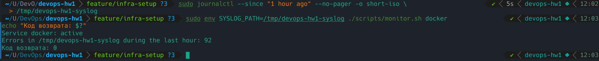
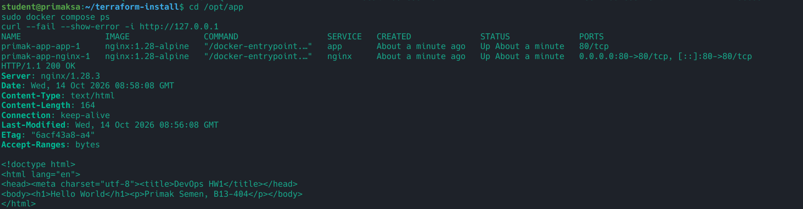
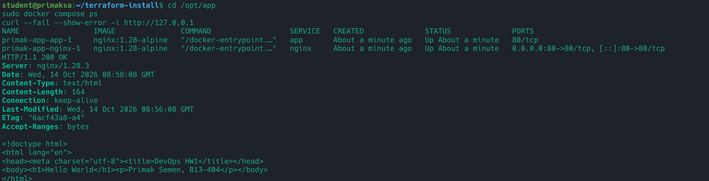
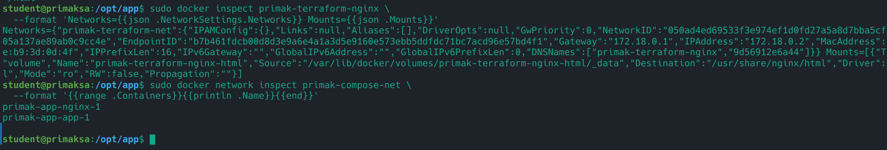

# ДЗ №1 — Фундамент DevOps-инфраструктуры

Примак Семён Алексеевич, группа Б13-404.
VM: `111.88.162.128`, исходный SSH-пользователь: `student`.

## Архитектура

Согласно уточнению Фёдора от 12 октября 2026 года, этап 2 PDF заменён
работой с провайдером `kreuzwerker/docker`. VM уже выдана; создавать
облачные VM, VPC, Security Group и IAM-ресурсы не требуется.
Сначала выполняется этап 3 (Ansible), затем Terraform.

| Часть | Ресурсы | Доступ |
| --- | --- | --- |
| Ansible | Docker Engine, Compose plugin, rsyslog, deployer, sudo | SSH как student, повышение прав через sudo |
| Terraform | nginx, сеть primak-terraform-net, том primak-terraform-nginx-html | HTTP :8081 |
| Compose | nginx reverse proxy → app nginx, сеть primak-compose-net | HTTP :80, Hello World |
| Bash | systemctl, journalctl, grep, awk | monitor.sh docker |

Terraform-nginx отдаёт стандартную статическую страницу nginx. Docker
заполняет новый именованный том HTML-файлами образа; контейнер монтирует
его только для чтения. Compose-приложение не публикует порт наружу:
запросы к нему идут через reverse proxy по имени `app` внутри своей сети.

`deployer` получает sudo без пароля по требованию задания. Членство в
группе Docker также даёт широкие права на хосте. SSH-вход остаётся через
`student`; роль не меняет его права и не настраивает вход root.
Публичный Docker TCP API не включается. Пароли и приватные ключи не хранятся
в Git. Terraform state сохраняется на VM и исключён из Git.

## Структура

- `ansible/` — inventory, роль настройки хоста, playbook деплоя Compose.
- `terraform/` — провайдер, переменные, сеть, том, образ и контейнер nginx.
- `compose/` — docker-compose.yml, reverse proxy, страница Hello World.
- `scripts/monitor.sh` — мониторинг сервиса и ошибок syslog.
- `tests/test_monitor.py` — проверки мониторинга с подставными сервисами.
- `docs/screenshots/` — сюда добавить реальные скриншоты для сдачи.

## 1. Подготовка управляющей машины

Нужны Python 3.10+, venv, SSH и доступ к Интернету. Команды выполняются
из корня проекта, если явно не указано другое.

```bash
python3 -m venv .venv
. .venv/bin/activate
pip install -r requirements.txt
ansible-galaxy collection install -r ansible/requirements.yml
ssh student@111.88.162.128
```

При первом подключении проверить SSH fingerprint через преподавателя.
Пароль запросить у преподавателя. Не повторять неудачные попытки входа:
на VM работает fail2ban. Настроить SSH-ключ после успешного входа:

```bash
ssh-copy-id student@111.88.162.128
```

Если SSH-ключ ещё не создан, сначала выполнить `ssh-keygen -t ed25519`.
Проверить на VM `sudo -v`: для Ansible нужны права sudo.

## 2. Ansible: настройка и идемпотентность

```bash
cd ansible
ansible-playbook setup_host.yml --syntax-check
ansible-playbook setup_host.yml --ask-become-pass
ansible-playbook setup_host.yml --ask-become-pass
```

Если sudo не требует пароля, флаг `--ask-become-pass` можно убрать.
При подключении по SSH-паролю добавить `--ask-pass` и установить `sshpass`
на управляющей машине. Предпочтителен настроенный SSH-ключ.

Второй запуск должен завершиться без ошибок и показать `changed=0`.
Роль использует модули Ansible для пакетов, файлов, пользователей и
сервисов. Обновление кеша apt ограничено сроком 3600 секунд; пакеты
устанавливаются с `state: present`, без принудительных обновлений.
Не удаляем существующие Docker-пакеты автоматически: если на выданной VM
есть конфликтующие пакеты, сначала нужно изучить их и текущие контейнеры.

## 3. Terraform на VM

На VM установить Terraform по официальной инструкции:
https://developer.hashicorp.com/terraform/install
Требуется версия `>=1.6, <2.0`. Terraform запускаем на VM, где находится
Docker socket; локальные команды Terraform управляющей машины создали
бы ресурсы на другой машине.

С управляющей машины из корня проекта:

```bash
ssh student@111.88.162.128 'mkdir -p ~/devops-hw1'
scp -r terraform student@111.88.162.128:~/devops-hw1/
ssh student@111.88.162.128
```

На VM:

```bash
cd ~/devops-hw1/terraform
sudo terraform init
sudo terraform fmt -check
sudo terraform validate
sudo terraform plan -out=infra.tfplan
sudo terraform apply infra.tfplan
sudo terraform state list
curl --fail --show-error -i http://127.0.0.1:8081
```

С управляющей машины проверить публичный доступ:

```bash
curl --fail --show-error -i http://111.88.162.128:8081
```

Ожидается `200 OK` и страница nginx. Порт можно изменить через
`-var=http_port=8082` при создании плана. Файл `.terraform.lock.hcl`,
созданный `init`, нужно вернуть в репозиторий и закоммитить; state,
план и каталог `.terraform/` коммитить нельзя. State не удалять:
Terraform использует его для сопоставления кода и реальных ресурсов.

## 4. Мониторинг

```bash
sudo ./scripts/monitor.sh docker
```

Аргумент — имя systemd-сервиса. Для неактивного/неизвестного сервиса
скрипт выводит последние 10 строк journalctl. В syslog выбираются строки
со словами error, err, failed, failure, fatal, critical и временными
метками за последний час. Считаются строки, не число слов.
Поддерживаются традиционные syslog timestamps и ISO timestamps с часовым
поясом. В традиционном формате используется локальное время хоста,
учитывается переход года. Отсутствие ошибок и пустой лог дают 0.

Коды возврата: `0` — сервис активен, проверка выполнена; `1` — сервис
неактивен/неизвестен; `2` — неверные аргументы, недоступный журнал или
ошибка инструмента. Для чтения журналов обычно нужен sudo. Если хост
не использует systemd или не имеет syslog, реальная проверка сообщит
об ограничении; это не успешный результат проверки.

Локальные тесты без Docker, systemd и доступа к VM:

```bash
python3 -m unittest discover -s tests -v
bash -n scripts/monitor.sh
```

`SYSLOG_PATH` позволяет задать файл журнала для проверки. На реальном
локальном Linux-хосте дополнительно выполнить `sudo ./scripts/monitor.sh docker`.

## 5. Compose на VM

С управляющей машины:

```bash
cd ansible
ansible-playbook deploy_compose.yml --ask-become-pass
```

Playbook копирует проект в `/opt/app`, устанавливает мониторинг и
запускает Compose. На VM проверить:

```bash
cd /opt/app
sudo docker compose ps
curl --fail --show-error -i http://127.0.0.1
sudo /usr/local/bin/monitor.sh docker
sudo docker network inspect primak-compose-net primak-terraform-net
sudo docker volume inspect primak-terraform-nginx-html
```

С управляющей машины:

```bash
curl --fail --show-error -i http://111.88.162.128
```

Ожидается `200 OK` и `Hello World`. Перед запуском убедиться, что порты
80 и 8081 свободны (`sudo ss -ltnp`). Если внешний curl недоступен,
проверить слушающие порты, журналы контейнеров и правила сети VM.

## 6. Результаты и Git workflow

Проверено на VM 14 октября 2026 года (вывод команд предоставлен автором):

- Ubuntu 24.04.4 LTS, Docker Engine 29.9.0, Compose 5.6.0.
- Ansible syntax-check успешен; первый запуск: `ok=11 changed=6 failed=0`,
  второй запуск: `changed=0 unreachable=0 failed=0`.
- Terraform 1.16.5, Docker-провайдер 3.9.0: validate успешен,
  plan/apply создали четыре ресурса, state list содержит все четыре.
- nginx на `http://111.88.162.128:8081` возвращает `200 OK`.
  Контейнер подключён только к `primak-terraform-net`, том
  `primak-terraform-nginx-html` смонтирован в `/usr/share/nginx/html` с `RW=false`.
- Compose playbook: `ok=4 changed=3 unreachable=0 failed=0`.
  Оба сервиса работают в `primak-compose-net`; внешний запрос
  `http://111.88.162.128` возвращает `200 OK` и Hello World.
- monitor.sh на VM: Docker active, код 0; отсутствующий сервис inactive,
  журнал пуст, код 1. В обоих запусках найдено 17 строк с признаками ошибок
  в общем syslog за последний час, что не означает 17 ошибок Docker.
- Локальные проверки Compose config, YAML и Bash прошли; пять тестов
  monitor.sh прошли. Локальный Docker активен, мониторинг завершился с кодом 0
  и посчитал 92 строки с признаками ошибок в выгрузке journald.

### Проблемы доступа при установке Terraform

На VM серверы `apt.releases.hashicorp.com` и `releases.hashicorp.com`
возвращали HTTP 404. Архив Terraform 1.16.5 и SHA256SUMS были скачаны
на управляющей машине; перед установкой необходимо проверить SHA256
по инструкции выше и передать архив по SCP.

Прямой `terraform init` на VM завершился ошибкой `Invalid provider registry host`.
Для установки Docker-провайдера использовано зеркало Yandex Cloud.
На VM создан файл `/home/student/terraform-mirror.tfrc`:

```hcl
provider_installation {
  network_mirror {
    url     = "https://terraform-mirror.yandexcloud.net/"
    include = ["registry.terraform.io/kreuzwerker/docker"]
  }
}
```

Инициализация:

```bash
sudo env TF_CLI_CONFIG_FILE=/home/student/terraform-mirror.tfrc terraform init
```

При установке через зеркало Terraform показал `unauthenticated`:
подпись издателя не была проверена. Lock-файл фиксирует версию и
контрольную сумму установленного провайдера для `linux_amd64`.

### Скриншоты

Второй запуск Ansible:



Создание ресурсов Terraform:



Состояние Terraform:



HTTP-ответ Terraform-nginx:



Локально `/var/log/syslog` недоступен даже с sudo: скрипт сообщил об этом
и вернул код 2. Для успешной проверки использована выгрузка реального
системного журнала, без изменения конфигурации локального логирования:

```bash
sudo journalctl --since "1 hour ago" --no-pager -o short-iso > /tmp/devops-hw1-syslog
sudo env SYSLOG_PATH=/tmp/devops-hw1-syslog ./scripts/monitor.sh docker
```

Локальная проверка мониторинга (код 0):



Работающие Compose-сервисы:



Внешний HTTP-запрос к reverse proxy:



Раздельные сети и том Terraform-nginx:



Осталось добавить скриншот мониторинга на VM. Его фактический результат
уже приведён выше; локальная проверка использовала выгрузку journald,
на VM использовался настоящий `/var/log/syslog`.

Рабочая ветка: `feature/infra-setup`. После подключения удалённого
репозитория отправить `main` и рабочую ветку, создать PR/MR, провести
само-ревью, выполнить слияние. После слияния поставить тег `v0.1.0`.
PR/MR и тег пока не создавались.

## Источники

- [Docker Engine для Ubuntu](https://docs.docker.com/engine/install/ubuntu/)
- [Ресурс docker_container](https://registry.terraform.io/providers/kreuzwerker/docker/latest/docs/resources/container)
- [Установка Terraform](https://developer.hashicorp.com/terraform/install)
